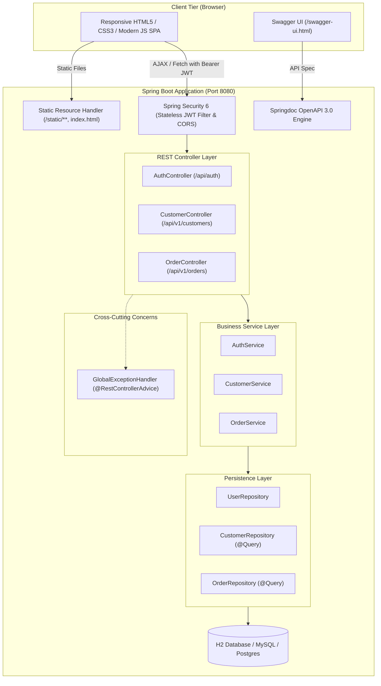

# Implementation Plan - Enterprise Java Full Stack Capstone Project

Transform the secure Spring Boot backend into an **Enterprise Full Stack Capstone Application** featuring an integrated, responsive **Single-Page Application (SPA) frontend**, **Springdoc OpenAPI / Swagger UI** interactive documentation, centralized **`@ControllerAdvice`** error handling, and end-to-end architecture documentation.

---

## Architecture Overview



---

## 1. User Review Required

> [!IMPORTANT]
> - **Frontend Architecture**: We will embed a modern, responsive Single-Page Application (SPA) inside `src/main/resources/static/index.html` (with modular CSS and JS). When you run `mvn spring-boot:run` and navigate to `http://localhost:8080/`, the full application loads immediately without needing a separate Node.js dev server.
> - **OpenAPI / Swagger UI**: Integrated using `springdoc-openapi-starter-webmvc-ui` (v2.3.0). Accessible at `http://localhost:8080/swagger-ui.html` and configured with a JWT Bearer `Authorize` button for interactive endpoint testing.
> - **Public Deliverable**: Everything will be committed to your existing GitHub repository (`https://github.com/JOHN9398/REST-API-Hibernate`), accompanied by comprehensive setup and walkthrough documentation.

---

## 2. Implementation Steps

### Step 1: Add Springdoc OpenAPI 3 & Swagger UI
- Add Maven dependency:
  ```xml
  <dependency>
      <groupId>org.springdoc</groupId>
      <artifactId>springdoc-openapi-starter-webmvc-ui</artifactId>
      <version>2.3.0</version>
  </dependency>
  ```
- Configure `OpenApiConfig.java` bean:
  - Document Title: *"Enterprise Order & Customer Management Portal API"*.
  - Version: `1.0.0`.
  - Security Scheme: `bearerAuth` (`HTTP` `bearer` with format `JWT`).
  - Applies security requirements globally to all protected `/api/v1/**` endpoints while leaving `/api/auth/**` public.
- Update `SecurityConfig.java`:
  - Grant `permitAll()` to:
    - `/swagger-ui/**`, `/swagger-ui.html`, `/v3/api-docs/**`
    - `/`, `/index.html`, `/static/**`, `/css/**`, `/js/**`

---

### Step 2: Global Exception Handling Verification
- Our backend already features a robust `@RestControllerAdvice` (`GlobalExceptionHandler.java`) handling:
  - `MethodArgumentNotValidException` $\rightarrow$ `400 Bad Request` with per-field validation error maps.
  - `ResourceNotFoundException` $\rightarrow$ `404 Not Found`.
  - `DuplicateResourceException` $\rightarrow$ `409 Conflict`.
  - `BadCredentialsException` $\rightarrow$ `401 Unauthorized`.
  - `AccessDeniedException` $\rightarrow$ `403 Forbidden`.
- The frontend will gracefully intercept these structured errors and display user-friendly toast alerts.

---

### Step 3: Responsive Enterprise Frontend Application
Create a production-quality enterprise dashboard in `src/main/resources/static/`:
- **File Structure**:
  - `index.html`: Modern semantic HTML5 layout with mobile-responsive sidebar, navbar, and content areas.
  - `css/app.css`: Custom modern styling (clean typography, card layouts, status badges, modal dialogs, responsive tables, animations).
  - `js/app.js`: Clean modular JavaScript handling:
    1. **Authentication State**:
       - Login & Register modal dialogs.
       - Token storage in `localStorage` (`jwt_token`, `current_user`).
       - Auto-injection of `Authorization: Bearer <token>` in all `fetch` requests.
       - Quick-login buttons for demo accounts (`Admin` & `User`).
       - Logout clearing session.
    2. **Real-Time Analytics Dashboard**:
       - Total Customers count.
       - Total Orders count.
       - Total Revenue ($ spent).
       - Active Orders counter.
    3. **Customer Management**:
       - Live search bar (filtering by name via `@Query` backend endpoint).
       - Data table with sorting and formatted dates.
       - Modal form to Add / Edit customer with client-side validation and backend error display.
       - Delete customer with role-check warning (Admin only).
    4. **Order Management**:
       - Order list with status badges (`PENDING`, `CONFIRMED`, `SHIPPED`, `CANCELLED`).
       - Create Order wizard with dynamic line items (add/remove item rows, live subtotal & total calculation).
       - Status update dropdown (`PUT /api/v1/orders/{id}/status`).
       - Detailed order view modal showing item breakdown.
    5. **API & Developer Hub**:
       - Direct launcher cards for **Swagger UI** (`/swagger-ui.html`), **H2 Console** (`/h2-console`), and **Postman Collection**.

---

### Step 4: Documentation & Video / Live Walkthrough Guide
- Update `README.md`:
  - Full project description and Capstone architecture.
  - System architecture diagram.
  - Step-by-step setup and local execution guide.
  - Default user credentials table (`admin`/`admin123`, `user`/`user123`).
  - Swagger UI & Postman instructions.
  - Step-by-step recording guide for the video walkthrough / live demo requirement.

---

## 3. Verification Plan

### Automated Backend Tests
Run full Maven test suite to verify zero regressions:
```powershell
& "C:\Users\sudhe\.gemini\antigravity\scratch\tools\apache-maven-3.9.6\bin\mvn.cmd" clean test -f "C:\Users\sudhe\.gemini\antigravity\scratch\REST-API-Hibernate\pom.xml"
```
Ensure:
1. 22/22 unit and integration tests pass.
2. Spring Boot context loads with Springdoc OpenAPI without conflicts.

### Manual Frontend & Swagger Verification
1. Launch the application:
   ```powershell
   & "C:\Users\sudhe\.gemini\antigravity\scratch\tools\apache-maven-3.9.6\bin\mvn.cmd" spring-boot:run -f "C:\Users\sudhe\.gemini\antigravity\scratch\REST-API-Hibernate\pom.xml"
   ```
2. Test Swagger UI at `http://localhost:8080/swagger-ui.html`.
3. Test Enterprise Frontend at `http://localhost:8080/` (register, login, create order, delete, filter).
